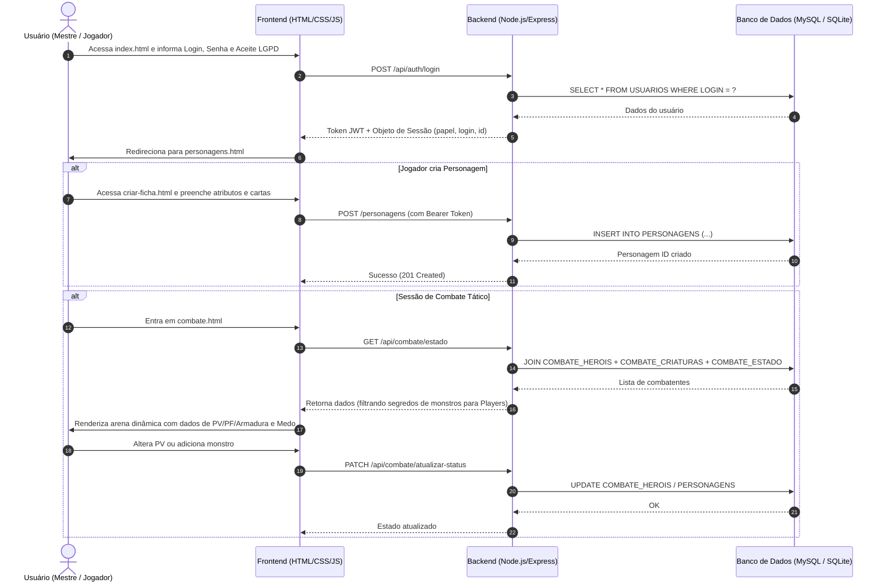
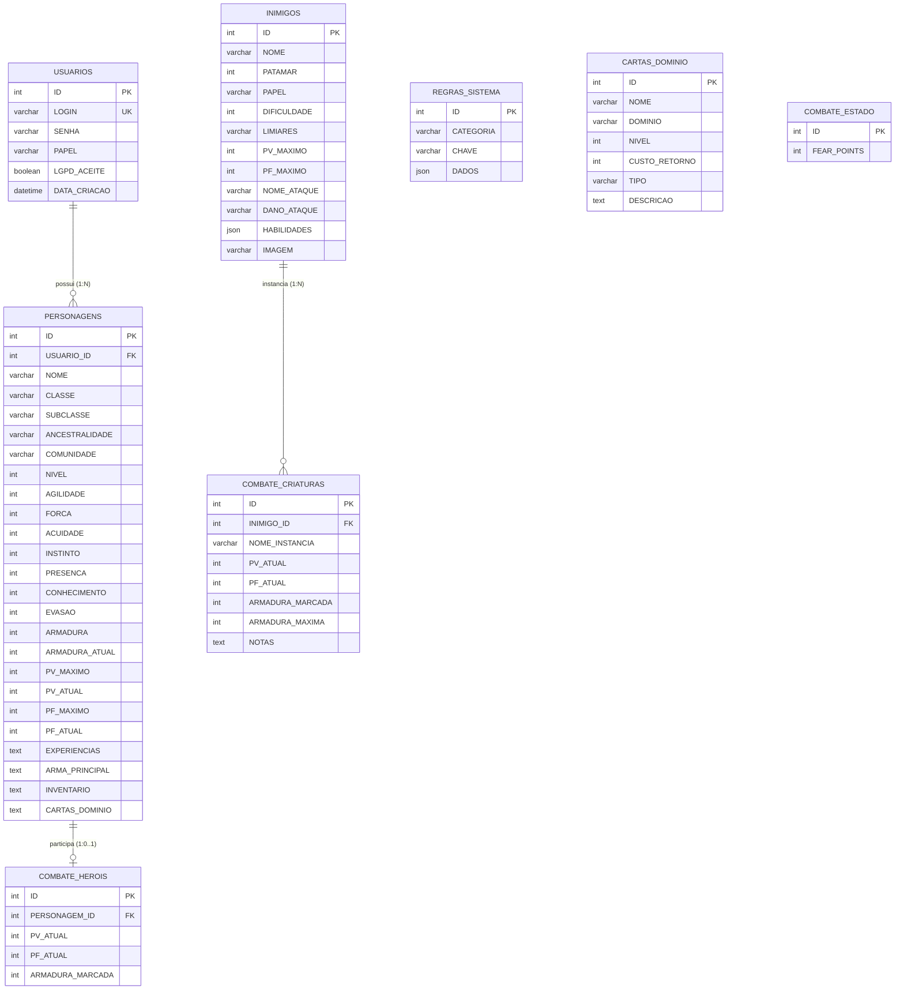

# 🗡️ Daggerheart VTT — Gerenciador de Fichas e Arena de Combate

> **Projeto Web Acadêmico — Solução para Jogos de Interpretação de Papéis (TTRPG)**  
> Plataforma Web Completa para Criação de Fichas Oficiais, Bestiário Integrado, Arena de Combate Sincronizada e Controle de Acesso em conformidade com a LGPD.

---

## 📌 Sumário
- [1. Identificação do Projeto e Contextualização](#1-identificação-do-projeto-e-contextualização)
  - [1.1 Nome do Projeto](#11-nome-do-projeto)
  - [1.2 Descrição do Problema](#12-descrição-do-problema)
  - [1.3 Público Afetado](#13-público-afetado)
  - [1.4 Justificativa e Proposta de Solução](#14-justificativa-e-proposta-de-solução)
- [2. Principais Funcionalidades Previstas](#2-principais-funcionalidades-previstas)
- [3. Perfis de Usuário e Níveis de Permissão](#3-perfis-de-usuário-e-níveis-de-permissão)
- [4. Fluxo Básico de Funcionamento](#4-fluxo-básico-de-funcionamento)
- [5. Arquitetura do Sistema e Estrutura de Pastas](#5-arquitetura-do-sistema-e-estrutura-de-pastas)
- [6. Modelagem do Banco de Dados Relacional](#6-modelagem-do-banco-de-dados-relacional)
  - [6.1 Diagrama Entidade-Relacionamento (ER)](#61-diagrama-entidade-relacionamento-er)
  - [6.2 Tabelas e Responsabilidades](#62-tabelas-e-responsabilidades)
- [7. Tecnologias Utilizadas](#7-tecnologias-utilizadas)
- [8. Como Executar o Projeto Localmente](#8-como-executar-o-projeto-localmente)
  - [8.1 Pré-requisitos](#81-pré-requisitos)
  - [8.2 Instalação e Execução](#82-instalação-e-execução)
  - [8.3 Credenciais de Acesso Pré-configuradas](#83-credenciais-de-acesso-pré-configuradas)
- [9. Mapeamento das Rotas da API REST](#9-mapeamento-das-rotas-da-api-rest)
- [10. Conformidade com a LGPD](#10-conformidade-com-a-lgpd)
- [11. Checklist de Atendimento da Entrega 1](#11-checklist-de-atendimento-da-entrega-1)

---

## 1. Identificação do Projeto e Contextualização

### 1.1 Nome do Projeto
**Daggerheart VTT & Character Manager** (Plataforma Web para Gestão de Fichas e Arena de Combate de Daggerheart RPG).

### 1.2 Descrição do Problema
O **Daggerheart** é um novo e aclamado sistema de RPG de mesa (*Tabletop Roleplaying Game - TTRPG*) desenvolvido pela *Darrington Press* (Critical Role). Diferente dos sistemas tradicionais baseados em d20 (*D&D*, *Pathfinder*), o Daggerheart introduz mecânicas narrativas inovadoras que dependem de constante cálculo e manipulação de múltiplos recursos:
- **Dados de Dualidade**: rolagem simultânea de 2d12 representando **Esperança** e **Medo**;
- **Limiares de Dano Triplo**: o dano não diminui pontos de vida linearmente, mas é classificado em *Dano Menor*, *Dano Maior* e *Dano Grave*, exigindo marcação de 1, 2 ou 3 Pontos de Vida (PV);
- **Slots de Armadura e Fadiga**: a armadura absorve dano marcando slots finitos de armadura, enquanto o esforço físico e poderes especiais consomem Pontos de Fadiga (PF);
- **Cartas de Domínio**: cada classe possui acesso a dois domínios arcanos/marciais com dezenas de cartas de habilidades, feitiços e talentos que precisam ser consultadas dinamicamente;
- **Bestiário com Ações Reativas e Contadores de Medo**: o Mestre acumula e consome *Pontos de Medo* para ativar reações e ataques mortais de monstros.

**O Problema Atual Identificado**: No jogo presencial ou em mesas remotas, o uso de fichas de papel ou editores de texto convencionais causa **alta sobrecarga cognitiva**, erros frequentes no cálculo de limiares, perda de tempo na busca de habilidades e lentidão no ritmo do combate. Além disso, os *Virtual Tabletops* (VTTs) genéricos existentes exigem assinaturas pagas, servidores complexos ou módulos complicados de terceiros, tornando o acesso difícil e burocrático para a comunidade brasileira de jogadores.

### 1.3 Público Afetado
1. **Mestres de RPG (Game Masters / Narradores)**: que enfrentam dificuldades para balancear encontros, monitorar PV/PF/Armadura de vários adversários simultaneamente e controlar os Pontos de Medo sem expor dados confidenciais aos jogadores.
2. **Jogadores de RPG (Players)**: que precisam de uma ferramenta ágil, acessível pelo navegador (computador ou celular), para criar personagens respeitando as regras oficiais, gerenciar inventário, cartas de domínio e acompanhar seus recursos em tempo real durante as sessões.
3. **Comunidade de RPG Independente**: grupos de amigos que buscam uma solução leve, gratuita, intuitiva e em português para organizar suas campanhas.

### 1.4 Justificativa e Proposta de Solução
A proposta deste projeto é desenvolver uma **solução web integrada, moderna e de alto desempenho**, unindo um construtor de fichas dinâmico, um acervo com as regras oficiais do jogo e uma arena de combate tático sincronizada:
- **Catálogo Oficial Embutido**: suporte completo para as 10 classes, dezenas de subclasses, 18 ancestralidades, 9 comunidades, 189 cartas de domínio e 129 inimigos oficiais cadastrados no banco de dados.
- **Ficha Grandona Interativa**: interface rica em estilo *Dark Fantasy Glassmorphism* que reproduz digitalmente a ficha oficial de Daggerheart, automatizando o cálculo de limiares, defesas e proficiências.
- **Arena de Combate Dinâmica**: sincronização instantânea de vida, estresse e armadura entre heróis e monstros, com controle centralizado do contador de Medo do Mestre.
- **Segurança e Privacidade (LGPD)**: controle de perfis de usuário (*Mestre* e *Jogador*), autenticação via JWT/sessão e conformidade com a Lei Geral de Proteção de Dados (consentimento expresso, minimização de dados e direito ao esquecimento com exclusão em cascata).

---

## 2. Principais Funcionalidades Previstas

| Módulo | Funcionalidades |
| :--- | :--- |
| **Autenticação & Sessão** | Login seguro, persistência de sessão, controle de permissões por perfil, aceitação obrigatória dos termos da LGPD e encerramento de sessão. |
| **Administração de Contas (Pai)** | Painel exclusivo da conta raiz (`mumu`) para auditoria de usuários cadastrados, criação de novos jogadores/mestres e exclusão de contas com remoção de dados vinculados. |
| **CRUD de Fichas de Personagem** | **Criar** fichas com seleção guiada de classe, ancestralidade e cartas; **Listar** fichas em grade visual; **Visualizar** a ficha completa em modal estilizado; **Editar** atributos, equipamentos e inventário; **Excluir** personagens do criador. |
| **Bestiário & Criaturas (Mestre)** | Visualização de 129 criaturas oficiais com patamares (1 a 4), papéis táticos, dificuldade, ataques e habilidades; inclusão, edição e remoção de monstros personalizados. |
| **Arena de Combate** | Adição de heróis e múltiplos monstros à arena; controle de PV atual, Fadiga atual e Armadura marcada; manipulação dos Pontos de Medo (0 a 10) pelo Mestre; filtros de privacidade para jogadores (ocultando atributos secretos dos monstros); reinicialização rápida da arena. |
| **Privacidade & LGPD** | Modal informativo detalhando a finalidade dos dados; botão de autoexclusão da conta e de todas as fichas associadas (Art. 18 da Lei nº 13.709/2018). |

---

## 3. Perfis de Usuário e Níveis de Permissão

O sistema implementa **controle estrito de permissões** tanto na interface visual (front-end) quanto nos middlewares e rotas da API (back-end):

```mermaid
flowchart TD
    User([Usuário]) --> Login{Autenticação & LGPD}
    Login -->|Perfil: Player| PlayerRole[Jogador / Player]
    Login -->|Perfil: Mestre| MasterRole[Mestre / Game Master]
    Login -->|Login: mumu| RootRole[Conta Pai de Administração]

    subgraph Permissões do Jogador
        PlayerRole --> P1[Criar, Editar e Excluir suas próprias fichas]
        PlayerRole --> P2[Visualizar seus personagens na listagem]
        PlayerRole --> P3[Adicionar seu herói ao combate e alterar seus próprios PV/PF/Armadura]
        PlayerRole --> P4[Ver apenas nome e imagem dos monstros no combate - Anti-Metagame]
        PlayerRole --> P5[Autoexcluir conta e fichas via LGPD]
    end

    subgraph Permissões do Mestre
        MasterRole --> M1[Visualizar fichas de todos os jogadores da mesa]
        MasterRole --> M2[Adicionar qualquer herói ou monstro ao combate]
        MasterRole --> M3[Ajustar vida, fadiga e armadura de qualquer combatente]
        MasterRole --> M4[Manipular os Pontos de Medo da mesa 0 a 10]
        MasterRole --> M5[Acessar Bestiário completo com táticas e ataques]
        MasterRole --> M6[Criar, atualizar e excluir criaturas customizadas]
    end

    subgraph Permissões da Conta Pai
        RootRole --> R1[Todas as permissões do Mestre]
        RootRole --> R2[Acessar Painel admin.html]
        RootRole --> R3[Listar todas as contas da mesa]
        RootRole --> R4[Criar novos usuários Mestre ou Player]
        RootRole --> R5[Remover contas de usuários em conformidade com a LGPD]
    end
```



---

## 4. Fluxo Básico de Funcionamento



---

## 5. Arquitetura do Sistema e Estrutura de Pastas

O projeto adota arquitetura em camadas no padrão **MVC (Model-View-Controller)** com separação rigorosa de responsabilidades entre front-end estático, rotas, controladores, middlewares e banco de dados:

```
DaggerHeart/
├── backend/                        # Servidor da API RESTful (Node.js + Express)
│   ├── controllers/                # Lógica de negócio e manipulação dos dados
│   │   ├── authController.js       # Autenticação, login, listagem e exclusão LGPD
│   │   ├── PersonagensController.js# CRUD de fichas e carregamento de regras
│   │   ├── combateController.js    # Lógica de arena, instâncias de combate e Medo
│   │   └── criaturasController.js  # Gestão do bestiário e monstros oficiais
│   ├── database/                   # Camada de persistência e conexão
│   │   ├── conexao.js              # Conexão MySQL com fallback automático para SQLite
│   │   └── daggerheart.sqlite      # Base SQLite local de desenvolvimento (ignorado no Git)
│   ├── middlewares/                # Interceptadores e regras de segurança
│   │   ├── authMiddleware.js       # Verificação de token, requireMestre e requirePai
│   │   └── corsMiddleware.js       # Configuração de CORS e cabeçalhos HTTP
│   ├── routes/                     # Definição e roteamento dos endpoints REST
│   │   ├── authRoutes.js           # Rotas /api/auth/*
│   │   ├── combateRoutes.js        # Rotas /api/combate/*
│   │   ├── criaturasRoutes.js      # Rotas /api/criaturas/*
│   │   └── personagensRoutes.js    # Rotas /personagens/*
│   ├── .env                        # Variáveis de ambiente locais (ignorado no Git)
│   ├── .env.example                # Modelo de variáveis de ambiente
│   ├── package.json                # Dependências do backend (express, mysql2, dotenv, cors)
│   └── server.js                   # Entrypoint principal da aplicação Node.js
│
├── frontend/                       # Interface do usuário (HTML5, CSS3, JavaScript puro)
│   ├── img/                        # Imagens locais e avatares de criaturas do bestiário
│   │   └── enemies/                # Tokens das criaturas oficiais do sistema
│   ├── admin.html                  # Painel de auditoria e criação de contas (Conta Pai)
│   ├── admin.js                    # Lógica do painel administrativo
│   ├── auth.js                     # Gerenciamento de sessão, token JWT e apiFetch
│   ├── banner.avif                 # Banner artístico de ambientação Dark Fantasy
│   ├── combate.html                # Arena de combate tático sincronizado
│   ├── combate.js                  # Lógica de combate, cálculo de dano e pontos de Medo
│   ├── criar-ficha.html            # Formulário completo de criação de ficha
│   ├── criar-ficha.js              # Seleção de classes, cálculo de atributos e inventário
│   ├── criaturas.html              # Bestiário e cadastro de monstros (Mestre)
│   ├── criaturas.js                # Listagem e edição de criaturas
│   ├── index.html                  # Tela de entrada, login de acesso e termo LGPD
│   ├── navbar.js                   # Componente global de cabeçalho, navegação e modal LGPD
│   ├── personagens.html            # Listagem de personagens e visualização da ficha completa
│   ├── personagens.js              # Renderização dos cards e modal da "Ficha Grandona"
│   └── style.css                   # Folha de estilos (Design System Dark Fantasy Glassmorphic)
│
├── sql/                            # Scripts de banco de dados
│   └── daggerheart.sql             # Script SQL completo (DDL relacional + DML com 370+ registros)
│
├── .gitignore                      # Arquivos e pastas desconsiderados no versionamento
└── README.md                       # Documentação completa do projeto
```

---

## 6. Modelagem do Banco de Dados Relacional

### 6.1 Diagrama Entidade-Relacionamento (ER)



### 6.2 Tabelas e Responsabilidades
1. **`USUARIOS`**: Armazena as credenciais de acesso, perfil de autorização (`mestre` ou `player`) e timestamp de consentimento com a LGPD.
2. **`PERSONAGENS`**: Tabela principal da entidade de domínio contendo mais de 40 atributos por personagem (atributos, limiares, defesas, equipamentos e cartas), vinculada via chave estrangeira `USUARIO_ID` com `ON DELETE CASCADE`.
3. **`REGRAS_SISTEMA`**: Tabela de parametrização com dados JSON das 10 classes, subclasses, 18 ancestralidades e 9 comunidades.
4. **`CARTAS_DOMINIO`**: Acervo com as 189 cartas oficiais de feitiços, talentos e grimórios de Daggerheart.
5. **`INIMIGOS`**: Bestiário oficial contendo 129 adversários catalogados com seus patamares, limiares de dano e blocos de habilidades.
6. **`COMBATE_HEROIS`**: Instâncias de personagens ativos na arena de combate com controle volátil de ferimentos e armadura.
7. **`COMBATE_CRIATURAS`**: Instâncias de monstros na arena (permitindo múltiplos exemplares do mesmo tipo com identificadores `#1`, `#2`, etc.).
8. **`COMBATE_ESTADO`**: Registro global do contador de Pontos de Medo (0 a 10) do Mestre da sessão.

---

## 7. Tecnologias Utilizadas

### Back-end
- **Node.js (v18+)**: Ambiente de execução JavaScript assíncrono baseado no motor V8.
- **Express (v4.21+)**: Framework web minimalista e robusto para criação de rotas, controllers e middlewares REST.
- **MySQL2 (v3.11+)**: Driver de alta performance com suporte a Promises e Prepared Statements para MySQL.
- **Node:SQLite (`DatabaseSync`)**: Driver SQLite nativo integrado ao Node.js utilizado como mecanismo automático de fallback para desenvolvimento e testes ágeis sem necessidade de subir um servidor MySQL local.
- **dotenv**: Carregamento seguro de variáveis de ambiente a partir de arquivo `.env`.
- **CORS**: Middleware para liberação e controle de cabeçalhos de requisição cruzada.

### Front-end
- **HTML5 Semântico**: Estruturação acessível com tags semânticas (`<header>`, `<main>`, `<section>`, `<aside>`).
- **CSS3 Moderno**: Variáveis CSS customizadas (*Design Tokens*), efeitos de vidro (*Glassmorphism* com `backdrop-filter`), animações suaves e layouts flexíveis (*CSS Grid* e *Flexbox*).
- **JavaScript Moderno (ES6+)**: Manipulação de DOM nativa, requisições assíncronas via `fetch()`, manipulação de `localStorage` para tokens de sessão e modais dinâmicos.
- **FontAwesome 6 & Google Fonts**: Tipografia temática (*Cinzel* para títulos medievais de fantasia e *Plus Jakarta Sans* para leitura clara da interface).

---

## 8. Como Executar o Projeto Localmente

### 8.1 Pré-requisitos
- **Node.js** instalado (versão 18 ou superior).
- *(Opcional)* **MySQL Server** (caso deseje utilizar MySQL; caso contrário, o sistema ativa automaticamente o SQLite local embutido).

### 8.2 Instalação e Execução

1. **Clone o repositório ou acesse a pasta do projeto**:
   ```bash
   cd "DaggerHeart"
   ```

2. **Acesse a pasta do backend e instale as dependências**:
   ```bash
   cd backend
   npm install
   ```

3. **Configuração de Variáveis de Ambiente (Opcional para MySQL)**:
   - O repositório já contém um arquivo `.env.example`. Se possuir MySQL local, crie o arquivo `.env`:
     ```env
     PORT=3000
     DB_HOST=localhost
     DB_PORT=3306
     DB_USER=root
     DB_PASSWORD=suasenha
     DB_NAME=DAGGERHEART
     ```
   - > **Nota de Fallback Automático**: Se você não tiver um banco MySQL rodando, **não se preocupe!** O sistema detecta a ausência de conexão com o MySQL e inicializa instantaneamente um banco **SQLite local** (`daggerheart.sqlite`) carregando integralmente o script `sql/daggerheart.sql` de forma 100% transparente.

4. **Inicie o servidor**:
   ```bash
   npm start
   ```
   *Ou diretamente via Node:*
   ```bash
   node server.js
   ```

5. **Acesse no Navegador**:
   Abra seu navegador em:
   ```
   http://localhost:3000
   ```

---

### 8.3 Credenciais de Acesso Pré-configuradas

O banco de dados já possui contas cadastradas para teste imediato de todos os perfis:

| Usuário | Senha | Perfil | Descrição e Permissões |
| :--- | :--- | :--- | :--- |
| **`mumu`** | `irado` | **Mestre + Conta Pai** | Acesso irrestrito a todas as fichas, controle do combate, bestiário completo e acesso ao Painel de Contas (`admin.html`). |
| **`jogador1`** | `123456` | **Player (Jogador)** | Cria e gerencia apenas suas fichas (já possui a personagem *Lyra Sombra-da-Noite* cadastrada), participa do combate com visão oculta dos monstros. |
| **`jogador2`** | `123456` | **Player (Jogador)** | Segundo jogador para simulação de mesas com múltiplos heróis simultâneos. |

---

## 9. Mapeamento das Rotas da API REST

### 🔐 Autenticação e Gestão de Usuários (`/api/auth`)
- `POST /api/auth/login`: Realiza autenticação, valida credenciais e aceite LGPD, retornando token e dados do perfil.
- `GET /api/auth/me`: Retorna os dados do usuário autenticado no token atual.
- `DELETE /api/auth/minha-conta`: Exclui permanentemente a conta do usuário e todas as suas fichas (Art. 18 LGPD).
- `GET /api/auth/usuarios` *(Restrito à Conta Pai)*: Lista todas as contas e permissões da mesa.
- `POST /api/auth/usuarios` *(Restrito à Conta Pai)*: Cria um novo usuário (*mestre* ou *player*).
- `DELETE /api/auth/usuarios/:id` *(Restrito à Conta Pai)*: Remove um usuário e seus dados associados.

### 📜 Fichas de Personagens (`/personagens`)
- `GET /personagens/dados-sistema`: Retorna o catálogo oficial de classes, subclasses, ancestralidades, comunidades e cartas.
- `GET /personagens`: Lista fichas (Mestre vê todas; Jogador vê apenas as suas).
- `GET /personagens/:id`: Retorna detalhes completos de uma ficha específica com verificação de posse.
- `POST /personagens`: Cria uma nova ficha completa de personagem com validação no backend.
- `PUT /personagens/:id`: Atualiza os atributos, inventário e recursos de um personagem existente.
- `DELETE /personagens/:id`: Remove o personagem do banco e retira-o da arena de combate caso esteja presente.

### ⚔️ Arena de Combate (`/api/combate`)
- `GET /api/combate/estado`: Retorna o estado atual da batalha (pontos de Medo, heróis e criaturas ativas).
- `PATCH /api/combate/medo` *(Restrito ao Mestre)*: Altera os Pontos de Medo da mesa (0 a 10).
- `POST /api/combate/adicionar-heroi`: Adiciona um personagem da mesa à batalha.
- `POST /api/combate/adicionar-criatura` *(Restrito ao Mestre)*: Adiciona uma ou mais instâncias de um monstro do bestiário.
- `PATCH /api/combate/atualizar-status`: Sincroniza PV, Fadiga, Armadura e Esperança dos combatentes.
- `DELETE /api/combate/remover/:tipo/:id`: Retira um herói ou criatura da arena de combate.
- `POST /api/combate/limpar` *(Restrito ao Mestre)*: Reinicia a arena de combate para um novo encontro.

### 🐉 Bestiário e Criaturas (`/api/criaturas`)
- `GET /api/criaturas`: Lista criaturas do bestiário (Mestre recebe bloco técnico completo; Jogadores recebem apenas nome e avatar).
- `GET /api/criaturas/:id`: Busca detalhes de uma criatura específica.
- `POST /api/criaturas` *(Restrito ao Mestre)*: Cadastra um novo monstro personalizado.
- `PUT /api/criaturas/:id` *(Restrito ao Mestre)*: Edita dados e habilidades de uma criatura.
- `DELETE /api/criaturas/:id` *(Restrito ao Mestre)*: Remove uma criatura do catálogo.

---

## 10. Conformidade com a LGPD

O sistema foi concebido respeitando os princípios fundamentais da **Lei Geral de Proteção de Dados (Lei nº 13.709/2018)**:
1. **Consentimento Expresso**: No primeiro acesso, o usuário deve assinalar o consentimento expresso dos termos de tratamento de dados para efetuar login.
2. **Minimização de Dados (Art. 6º, III)**: A aplicação não solicita CPF, dados biométricos, endereço, telefone ou dados de pagamento. Coletam-se exclusivamente o nome de usuário (login) e os dados de fichas lúdicas criadas para o jogo.
3. **Direito ao Esquecimento e Revogação (Art. 18, VI)**: Todo jogador possui em sua interface (via modal global da barra de navegação) um botão seguro para **exclusão definitiva de sua conta**, apagando imediatamente todas as suas fichas e registros do banco de dados em cascata.

---

## 11. Checklist de Atendimento da Entrega 1

Abaixo, demonstra-se a conformidade com todos os itens exigidos no edital da **Primeira Entrega**:

| Requisito do Edital | Status | Onde Encontrar no Projeto |
| :--- | :---: | :--- |
| **Nome do projeto, descrição do problema, público afetado e proposta de solução** | ✅ Concluído | Seção 1 deste `README.md`. |
| **Principais funcionalidades previstas** | ✅ Concluído | Seção 2 deste `README.md`. |
| **Tipos de usuários e ações previstas para cada perfil** | ✅ Concluído | Seção 3 deste `README.md` com matriz de permissões. |
| **Fluxo básico de funcionamento do sistema** | ✅ Concluído | Seção 4 com diagrama de sequência Mermaid. |
| **Estrutura inicial com backend, frontend, sql, README.md e .gitignore** | ✅ Concluído | Repositório estruturado em pastas isoladas e limpas. |
| **Back-end planejado com rotas, controllers, middlewares e database** | ✅ Concluído | Pastas `backend/routes`, `backend/controllers`, `backend/middlewares`, `backend/database`. |
| **Script SQL disponível com tabelas relacionadas** | ✅ Concluído | Arquivo `sql/daggerheart.sql` com 8 tabelas e integridade referencial. |
| **Organização do GitHub (.gitignore sem arquivos sensíveis)** | ✅ Concluído | `.gitignore` configurado excluindo `node_modules`, `.env` e bancos temporários. |

---

*Desenvolvido para a disciplina de Desenvolvimento Web — Projeto de Solução de Problema Atual.*
