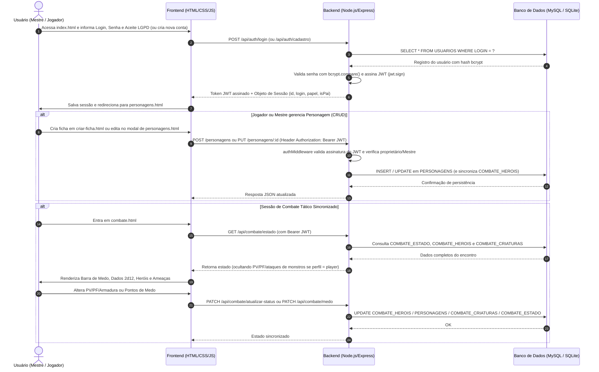
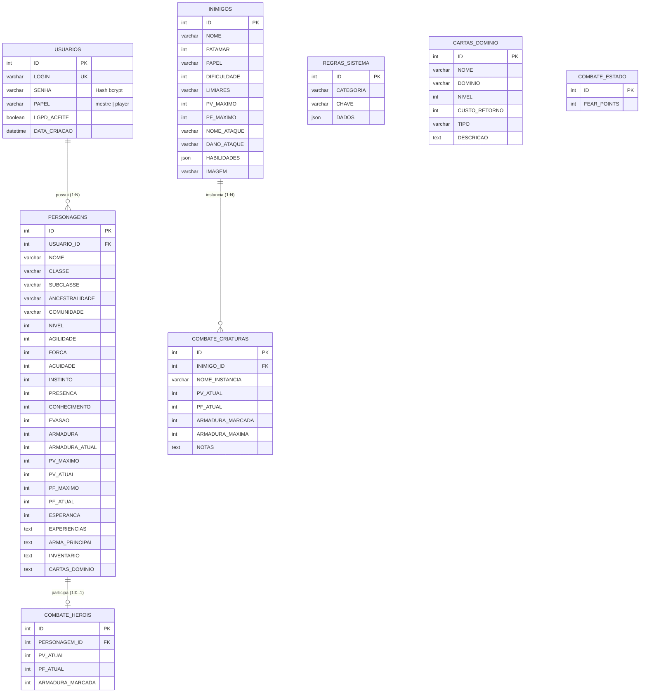

# 🗡️ Daggerheart VTT — Gerenciador de Fichas e Arena de Combate

> **Projeto Web Acadêmico — Solução para Jogos de Interpretação de Papéis (TTRPG)**  
> Plataforma Web Completa para Criação de Fichas Oficiais, Bestiário Integrado, Arena de Combate Sincronizada e Controle de Acesso em conformidade com a LGPD.

---

## 📌 Sumário
- [1. Identificação do Projeto e Contextualização](#1-identificação-do-projeto-e-contextualização)
  - [1.1 Nome do Projeto](#11-nome-do-projeto)
  - [1.2 Descrição do Problema](#12-descrição-do-problema)
  - [1.3 Público Afetado](#13-público-afetado)
  - [1.4 Justificativa e Proposta de Solução](#14-justificativa-e-proposta-de-solução)
- [2. Funcionalidades: Planejadas vs. Implementadas e Verificadas](#2-funcionalidades-planejadas-vs-implementadas-e-verificadas)
  - [2.1 Visão Geral por Módulo](#21-visão-geral-por-módulo)
  - [2.2 Diferenciação entre Planejado e Implementado por Entrega](#22-diferenciação-entre-planejado-e-implementado-por-entrega)
- [3. Perfis de Usuário e Níveis de Permissão](#3-perfis-de-usuário-e-níveis-de-permissão)
- [4. Fluxo Básico de Funcionamento](#4-fluxo-básico-de-funcionamento)
- [5. Arquitetura do Sistema e Estrutura de Pastas](#5-arquitetura-do-sistema-e-estrutura-de-pastas)
- [6. Modelagem do Banco de Dados Relacional](#6-modelagem-do-banco-de-dados-relacional)
  - [6.1 Diagrama Entidade-Relacionamento (ER)](#61-diagrama-entidade-relacionamento-er)
  - [6.2 Tabelas e Responsabilidades](#62-tabelas-e-responsabilidades)
- [7. Tecnologias Utilizadas e Segurança](#7-tecnologias-utilizadas-e-segurança)
- [8. Como Executar e Testar o Projeto Localmente](#8-como-executar-e-testar-o-projeto-localmente)
  - [8.1 Pré-requisitos](#81-pré-requisitos)
  - [8.2 Instalação e Execução Passo a Passo](#82-instalação-e-execução-passo-a-passo)
  - [8.3 Credenciais de Acesso Pré-configuradas](#83-credenciais-de-acesso-pré-configuradas)
  - [8.4 Roteiro de Testes das Funcionalidades](#84-roteiro-de-testes-das-funcionalidades)
- [9. Mapeamento das Rotas da API REST](#9-mapeamento-das-rotas-da-api-rest)
- [10. Conformidade com a LGPD](#10-conformidade-com-a-lgpd)
- [11. Checklist de Atendimento das Entregas (1, 2, 3 e 4)](#11-checklist-de-atendimento-das-entregas-1-2-3-e-4)

---

## 1. Identificação do Projeto e Contextualização

### 1.1 Nome do Projeto
**Daggerheart VTT & Character Manager** (Plataforma Web para Gestão de Fichas e Arena de Combate de Daggerheart RPG).

### 1.2 Descrição do Problema
O **Daggerheart** é um sistema de RPG de mesa (*Tabletop Roleplaying Game - TTRPG*) desenvolvido pela *Darrington Press* (Critical Role). Diferente dos sistemas tradicionais baseados em d20 (*D&D*, *Pathfinder*), o Daggerheart introduz mecânicas narrativas que dependem de constante cálculo e manipulação de múltiplos recursos:
- **Dados de Dualidade**: rolagem simultânea de 2d12 representando **Esperança** e **Medo**;
- **Limiares de Dano Triplo**: o dano não diminui pontos de vida linearmente, mas é classificado em *Dano Menor*, *Dano Maior* e *Dano Grave*, exigindo marcação de 1, 2 ou 3 Pontos de Vida (PV);
- **Slots de Armadura e Fadiga**: a armadura absorve dano marcando slots finitos de armadura, enquanto o esforço físico e poderes especiais consomem Pontos de Fadiga (PF);
- **Cartas de Domínio**: cada classe possui acesso a dois domínios arcanos/marciais com dezenas de cartas de habilidades, feitiços e talentos que precisam ser consultadas dinamicamente;
- **Bestiário com Ações Reativas e Contadores de Medo**: o Mestre acumula e consome *Pontos de Medo* para ativar reações e ataques mortais de monstros.

**O Problema Atual Identificado**: No jogo presencial ou em mesas remotas, o uso de fichas de papel ou editores de texto convencionais causa **alta sobrecarga cognitiva**, erros frequentes no cálculo de limiares, perda de tempo na busca de habilidades e lentidão no ritmo do combate. Além disso, os *Virtual Tabletops* (VTTs) genéricos existentes exigem assinaturas pagas, servidores complexos ou módulos complicados de terceiros, tornando o acesso difícil e burocrático para a comunidade brasileira de jogadores.

### 1.3 Público Afetado
1. **Mestres de RPG (Game Masters / Narradores)**: que enfrentam dificuldades para balancear encontros, monitorar PV/PF/Armadura de vários adversários simultaneamente e controlar os Pontos de Medo sem expor dados confidenciais aos jogadores.
2. **Jogadores de RPG (Players)**: que precisam de uma ferramenta ágil, acessível pelo navegador (computador ou celular), para criar personagens respeitando as regras oficiais, gerenciar inventário, cartas de domínio e acompanhar seus recursos em tempo real durante as sessões.
3. **Comunidade de RPG Independente**: grupos de amigos que buscam uma solução leve, gratuita, intuitiva e em português para organizar suas campanhas.

### 1.4 Justificativa e Proposta de Solução
A proposta deste projeto é desenvolver uma **solução web integrada, minimalista, moderna e de alto desempenho**, unindo um construtor de fichas dinâmico, um acervo com as regras oficiais do jogo e uma arena de combate tático sincronizada:
- **Catálogo Oficial Embutido**: suporte completo para as 10 classes, dezenas de subclasses, 18 ancestralidades, 9 comunidades, 189 cartas de domínio e 129 inimigos oficiais cadastrados no banco de dados.
- **Ficha Oficial Interativa**: interface moderna em estilo *Dark Fantasy Glassmorphism* que reproduz digitalmente a ficha oficial de Daggerheart, automatizando o cálculo de limiares, defesas e proficiências.
- **Arena de Combate Dinâmica**: sincronização instantânea de vida, fadiga e armadura entre heróis e monstros, com controle centralizado do contador de Medo do Mestre e rolador de Dados de Dualidade (2d12).
- **Segurança Real (JWT + Bcrypt) e Privacidade (LGPD)**: controle estrito de perfis de usuário (*Mestre*, *Jogador* e *Conta Pai*) validado no backend, tokens JWT assinados criptograficamente, senhas com hash `bcrypt` (nunca expostas na API) e conformidade com a Lei Geral de Proteção de Dados (consentimento expresso, minimização de dados e direito ao esquecimento com exclusão em cascata).

---

## 2. Funcionalidades: Planejadas vs. Implementadas e Verificadas

Em atendimento às recomendações de avaliação da disciplina, esta seção diferencia claramente o escopo **previsto no projeto** daquilo que já se encontra **efetivamente implementado, integrado e verificado** no código-fonte atual.

### 2.1 Visão Geral por Módulo

| Módulo | Funcionalidades Previstas no Escopo | Status Atual | Como está Implementado e Verificado no Sistema |
| :--- | :--- | :---: | :--- |
| **Autenticação & Segurança** | Cadastro e login de usuários com senhas criptografadas (`bcrypt`), sessão via JWT assinado (`jsonwebtoken`) e proteção de rotas por middleware. | ✅ **Implementado e Verificado** | `authController.js` realiza hash `bcrypt.hash(senha, 10)` no cadastro e `bcrypt.compare` no login. Tokens gerados com `jwt.sign` e validados exclusivamente via `jwt.verify` em `authMiddleware.js`. Nenhuma rota retorna o campo `SENHA`. |
| **Controle de Acesso e Perfis (RBAC)** | Distinção entre `player`, `mestre` e Conta Pai (`mumu`) com validação obrigatória no backend e adaptação visual no frontend. | ✅ **Implementado e Verificado** | Middlewares `authMiddleware`, `requireMestre` e `requirePai` bloqueiam ações não autorizadas no servidor (`403 Forbidden`). Players só editam/excluem suas próprias fichas e não recebem status ocultos de monstros na API. |
| **Administração de Contas (Conta Pai)** | Painel para listar contas, cadastrar novos usuários, alternar perfil (`player` ↔ `mestre`) e excluir contas com limpeza em cascata. | ✅ **Implementado e Verificado** | Página `admin.html` + `admin.js` consumindo `GET /api/auth/usuarios`, `POST /api/auth/usuarios`, `PUT /api/auth/usuarios/:id/papel` e `DELETE /api/auth/usuarios/:id` sem expor hashes de senha. |
| **CRUD Completo de Personagens** | Criar, listar (cards/tabela), filtrar, buscar por ID/nome, visualizar ficha completa, editar atributos/recursos/inventário/cartas e excluir. | ✅ **Implementado e Verificado** | Páginas `personagens.html` e `criar-ficha.html` integradas via `fetch` às rotas `GET`, `POST`, `PUT` e `DELETE` de `/personagens`, persistindo mais de 40 campos e sincronizando PV/PF/Armadura com a arena. |
| **CRUD Completo do Bestiário (Mestre)** | Catálogo com 129 criaturas oficiais, filtros por patamar/papel/nome, criação de monstros customizados, edição em modal e exclusão. | ✅ **Implementado e Verificado** | Página `criaturas.html` + `criaturas.js` integrada às rotas `GET`, `POST`, `PUT` e `DELETE` de `/api/criaturas` (protegidas por `requireMestre`). |
| **Arena de Combate & Dados 2d12** | Barra de Medo (0–10), rolador de Dados de Dualidade (2d12), adição de heróis e monstros, controle interativo de PV/PF/Armadura/Esperança e visão anti-metagame. | ✅ **Implementado e Verificado** | Página `combate.html` + `combate.js` integrada a `/api/combate/*`. Ao rolar resultado "Com Medo" nos dados 2d12 como Mestre, o contador de Medo incrementa automaticamente no banco. |
| **Conformidade LGPD** | Termo de aceite obrigatório no login/cadastro, política de minimização de dados e botão de autoexclusão da conta e fichas (Direito ao Esquecimento). | ✅ **Implementado e Verificado** | Modal global em `navbar.js` e `index.html` + endpoint `DELETE /api/auth/minha-conta` que remove os personagens, instâncias de combate e o registro do usuário. |

### 2.2 Diferenciação entre Planejado e Implementado por Entrega

| Etapa do Projeto | O que era Previsto para a Etapa | Estado Atual no Repositório |
| :--- | :--- | :--- |
| **Entrega 1** *(Problema e Estrutura)* | Definição do problema, perfis, fluxo, estrutura inicial (`backend`, `frontend`, `sql`, `.gitignore`, `README.md`) e modelagem SQL inicial. | **100% Concluído e Refinado**: Documentação atualizada e alinhada ao estado real do código, sem divergências entre teoria e prática. |
| **Entrega 2** *(Banco de Dados e Autenticação)* | Banco relacional com chaves primárias/estrangeiras, script SQL, cadastro/login integrados ao banco, hash de senha (`bcrypt`), JWT assinado e middlewares de perfil. | **100% Concluído e Corrigido**: Substituído qualquer uso antigo de Base64 ou texto puro por `jsonwebtoken` (`jwt.sign`/`jwt.verify`) e `bcryptjs` em todas as contas, além de remover completamente o campo `SENHA` das respostas da API. |
| **Entrega 3** *(CRUD e Integração Front/Back)* | CRUD completo da entidade principal (`PERSONAGENS`) e secundárias (`INIMIGOS`, `USUARIOS`, `COMBATE`), integração via `fetch()`, manipulação de DOM, feedback visual e regras de negócio. | **100% Concluído e Verificado**: Todas as operações de criação, listagem, atualização e exclusão funcionam pela interface web com atualização imediata do DOM e validação no backend. |
| **Entrega 4** *(Integração Final)* | Sistema web completo, interface moderna e responsiva, fluxos integrados de ponta a ponta e documentação final para execução local imediata. | **100% Concluído e Verificado**: Sistema pronto para apresentação e execução local com MySQL ou fallback automático SQLite. |

---

## 3. Perfis de Usuário e Níveis de Permissão

O sistema implementa **controle estrito de permissões** tanto na interface visual (front-end) quanto nos middlewares e rotas da API (back-end):

```mermaid
flowchart TD
    User([Usuário]) --> Login{Autenticação JWT & LGPD}
    Login -->|Perfil: Player| PlayerRole[Jogador / Player]
    Login -->|Perfil: Mestre| MasterRole[Mestre / Game Master]
    Login -->|Login: mumu| RootRole[Conta Pai de Administração]

    subgraph Permissões do Jogador
        PlayerRole --> P1[Criar, Editar e Excluir apenas suas próprias fichas]
        PlayerRole --> P2[Visualizar seus personagens na listagem]
        PlayerRole --> P3[Adicionar seu herói ao combate e alterar seus próprios PV/PF/Armadura/Esperança]
        PlayerRole --> P4[Ver apenas nome e imagem dos monstros no combate - Anti-Metagame]
        PlayerRole --> P5[Autoexcluir sua conta e fichas via LGPD]
    end

    subgraph Permissões do Mestre
        MasterRole --> M1[Visualizar e editar fichas de todos os jogadores da mesa]
        MasterRole --> M2[Adicionar qualquer herói ou monstro ao combate]
        MasterRole --> M3[Ajustar vida, fadiga, armadura e notas de qualquer combatente]
        MasterRole --> M4[Manipular os Pontos de Medo da mesa de 0 a 10]
        MasterRole --> M5[Acessar Bestiário completo com 129 criaturas, táticas e ataques]
        MasterRole --> M6[Criar, editar e excluir criaturas customizadas]
    end

    subgraph Permissões da Conta Pai
        RootRole --> R1[Todas as permissões do Mestre]
        RootRole --> R2[Acessar Painel de Contas admin.html]
        RootRole --> R3[Listar contas sem exposição de senhas]
        RootRole --> R4[Criar usuários e alternar papel entre Mestre e Jogador]
        RootRole --> R5[Remover contas de usuários com exclusão em cascata]
    end
```



---

## 4. Fluxo Básico de Funcionamento



---

## 5. Arquitetura do Sistema e Estrutura de Pastas

O projeto adota arquitetura em camadas com separação clara de responsabilidades entre front-end estático, rotas, controladores, middlewares de segurança e camada de persistência:

```
daggerheart/
├── backend/                        # Servidor da API RESTful (Node.js + Express)
│   ├── controllers/                # Regras de negócio e manipulação dos dados
│   │   ├── authController.js       # Login, cadastro, hash bcrypt, JWT, troca de papel e exclusão LGPD
│   │   ├── PersonagensController.js# CRUD completo de fichas e carregamento de regras do sistema
│   │   ├── combateController.js    # Lógica da arena de combate, instâncias e Pontos de Medo
│   │   └── criaturasController.js  # CRUD completo do bestiário e filtro anti-metagame
│   ├── database/                   # Camada de persistência e conexão
│   │   ├── conexao.js              # Conexão MySQL com fallback automático para SQLite nativo
│   │   └── daggerheart.sqlite      # Base SQLite local gerada automaticamente (ignorada no Git)
│   ├── middlewares/                # Interceptadores de autenticação e autorização
│   │   ├── authMiddleware.js       # Validação estrita de JWT (jwt.verify), requireMestre e requirePai
│   │   └── corsMiddleware.js       # Configuração de CORS e cabeçalhos HTTP
│   ├── routes/                     # Definição dos endpoints REST
│   │   ├── authRoutes.js           # Rotas /api/auth/*
│   │   ├── combateRoutes.js        # Rotas /api/combate/*
│   │   ├── criaturasRoutes.js      # Rotas /api/criaturas/*
│   │   └── personagensRoutes.js    # Rotas /personagens/*
│   ├── .env                        # Variáveis de ambiente locais (ignorado no Git)
│   ├── .env.example                # Modelo documentado de variáveis de ambiente
│   ├── package.json                # Dependências do backend (express, mysql2, jsonwebtoken, bcryptjs, dotenv, cors)
│   └── server.js                   # Ponto de entrada da aplicação Node.js
│
├── frontend/                       # Interface do usuário (HTML5, CSS3 Moderno, JavaScript ES6+)
│   ├── img/                        # Ativos visuais e tokens das criaturas do bestiário
│   │   └── enemies/                # Avatares das 129 criaturas oficiais
│   ├── admin.html & admin.js       # Painel administrativo de contas e permissões (Conta Pai)
│   ├── auth.js                     # Gestão de sessão JWT no cliente e wrapper apiFetch()
│   ├── banner.avif                 # Arte de capa do cabeçalho
│   ├── combate.html & combate.js   # Arena de combate, Barra de Medo (0-10) e Rolador 2d12
│   ├── criar-ficha.html & .js      # Construtor interativo da Ficha Oficial de Daggerheart
│   ├── criaturas.html & .js        # Bestiário completo com busca, criação, edição e exclusão
│   ├── index.html                  # Portal de entrada (Login, Cadastro, Acesso Rápido Demo e LGPD)
│   ├── navbar.js                   # Barra de navegação global responsiva e modal de privacidade LGPD
│   ├── personagens.html & .js      # Grimório de heróis (Cards e Tabela) e modal de edição da ficha
│   └── style.css                   # Design System minimalista e moderno (Dark Fantasy Glassmorphism)
│
├── sql/                            # Scripts de banco de dados
│   └── daggerheart.sql             # Script SQL completo (DDL relacional + DML com 370+ registros oficiais)
│
├── .gitignore                      # Proteção contra versionamento de node_modules, .env e arquivos locais
└── README.md                       # Documentação completa do projeto
```

---

## 6. Modelagem do Banco de Dados Relacional

### 6.1 Diagrama Entidade-Relacionamento (ER)



### 6.2 Tabelas e Responsabilidades
1. **`USUARIOS`**: Armazena login único, senha criptografada com `bcrypt`, perfil de autorização (`mestre` ou `player`) e confirmação de aceite da LGPD.
2. **`PERSONAGENS`**: Entidade principal contendo os atributos, limiares de dano, trilhas de PV/PF/Armadura/Esperança, armas, inventário e cartas de domínio, vinculada a `USUARIOS(ID)` via chave estrangeira com `ON DELETE CASCADE`.
3. **`REGRAS_SISTEMA`**: Catálogo estruturado em JSON com as 10 classes, subclasses, 18 ancestralidades e 9 comunidades oficiais.
4. **`CARTAS_DOMINIO`**: Acervo com as 189 cartas oficiais de domínio de Daggerheart.
5. **`INIMIGOS`**: Bestiário oficial com 129 criaturas catalogadas por patamar (1 a 4), papel tático, dificuldade, limiares, ataques e habilidades especiais.
6. **`COMBATE_HEROIS`**: Instâncias de personagens ativos na arena de combate, sincronizadas em tempo real com a tabela `PERSONAGENS`.
7. **`COMBATE_CRIATURAS`**: Instâncias de monstros ativos na arena (permitindo múltiplos exemplares do mesmo inimigo com notas e vida independentes).
8. **`COMBATE_ESTADO`**: Armazena o contador global de Pontos de Medo (0 a 10) da mesa.

---

## 7. Tecnologias Utilizadas e Segurança

### Back-end & Segurança
- **Node.js (v18+) & Express (v4.21+)**: Servidor HTTP e roteamento RESTful modular.
- **JSON Web Token (`jsonwebtoken`)**: Emissão de tokens JWT assinados com chave secreta (`JWT_SECRET` do `.env`) e expiração de 24 horas (`expiresIn: "24h"`). O middleware `authMiddleware.js` aceita exclusivamente tokens JWT válidos assinados pelo servidor.
- **Bcrypt (`bcryptjs`)**: Criptografia unidirecional de senhas com *salt* de 10 rounds (`bcrypt.hash` e `bcrypt.compare`). Tanto os usuários criados via tela de cadastro/painel admin quanto os usuários iniciais do script `sql/daggerheart.sql` utilizam hashes `bcrypt` válidos.
- **Ocultação Estrita de Credenciais**: Nenhum endpoint da API (`GET /api/auth/usuarios`, `POST /api/auth/login`, `GET /api/auth/me`) retorna o campo `SENHA` (nem mesmo em formato hash).
- **MySQL2 + Fallback Automático SQLite (`node:sqlite`)**: Conexão primária via pool MySQL (`mysql2/promise`) configurada por variáveis de ambiente (`.env`), com fallback transparente para SQLite nativo caso o serviço MySQL não esteja ativo na máquina de avaliação.

### Front-end
- **HTML5 Semântico & CSS3 Moderno**: Interface minimalista e responsiva com variáveis CSS, *Glassmorphism*, layout em *Grid/Flexbox* e tipografia temática (*Cinzel* + *Plus Jakarta Sans*).
- **JavaScript Puro (Vanilla ES6+)**: Consumo assíncrono da API REST com `fetch()`, tratamento de erros HTTP (`401`, `403`, `404`, `500`), atualização dinâmica do DOM sem recarregamento de página e controle de estado no cliente.

---

## 8. Como Executar e Testar o Projeto Localmente

### 8.1 Pré-requisitos
- **Node.js** instalado (versão 18, 20 ou 22+).
- *(Opcional)* **MySQL Server** (se o MySQL não estiver rodando localmente, o sistema inicializa automaticamente o banco SQLite local usando o mesmo arquivo `sql/daggerheart.sql`).

### 8.2 Instalação e Execução Passo a Passo

1. **Abra o terminal na pasta do projeto e acesse o diretório `backend`**:
   ```bash
   cd backend
   ```

2. **Instale as dependências do Node.js** (`node_modules`):
   ```bash
   npm install
   ```

3. **Configure o arquivo `.env` na pasta `backend/`**:
   Crie um arquivo chamado `.env` dentro de `backend/` (ou copie de `.env.example`) com o seguinte conteúdo:
   ```env
   PORT=3000
   DB_HOST=localhost
   DB_PORT=3306
   DB_USER=root
   DB_PASSWORD=admin
   DB_NAME=DAGGERHEART
   JWT_SECRET=daggerheart_super_secret_jwt_key_2026
   ```

4. **Inicie o servidor**:
   ```bash
   npm start
   ```

5. **Acesse a aplicação no navegador**:
   ```
   http://localhost:3000
   ```

---

### 8.3 Credenciais de Acesso Pré-configuradas

Na tela inicial (`http://localhost:3000`), você pode digitar as credenciais abaixo, usar os **botões de Preenchimento Rápido** ou criar uma nova conta na aba **"Criar Nova Conta"**:

| Usuário | Senha | Perfil | O que testar com esta conta |
| :--- | :--- | :--- | :--- |
| **`mumu`** | `irado` | **Mestre + Conta Pai** | Visualiza e edita todas as fichas, controla a Barra de Medo e os monstros no combate, gerencia o Bestiário (`criaturas.html`) e acessa o Painel de Contas (`admin.html`). |
| **`jogador1`** | `123456` | **Player (Jogador)** | Possui a ficha inicial *Lyra Sombra-da-Noite*. Pode criar novas fichas, editar apenas seus heróis e ver os monstros em combate com estatísticas ocultas. |
| **`jogador2`** | `123456` | **Player (Jogador)** | Segundo jogador para testar isolamento de permissão entre jogadores diferentes. |

---

### 8.4 Roteiro de Testes das Funcionalidades

1. **Autenticação, Cadastro e Perfis**:
   - Na tela inicial (`index.html`), clique nos botões de preenchimento rápido ou cadastre um novo usuário escolhendo entre *Jogador* ou *Mestre*.
   - Verifique no topo direito da barra de navegação a identificação do usuário logado e seu crachá de perfil.
2. **CRUD de Personagens (`personagens.html` e `criar-ficha.html`)**:
   - Clique em **Criar Personagem** para abrir a forja interativa: escolha Classe (ex.: *Bardo*, *Feiticeiro*, *Guardião*), Subclasse, Ancestralidade (Única ou Mista), Comunidade e Cartas de Domínio. Os atributos, limiares e habilidades são preenchidos automaticamente.
   - Em **Heróis & Fichas**, alterne entre a visão em **Cards** e **Tabela**, filtre por nome/jogador e clique em qualquer herói para abrir a **Ficha Oficial Completa**, editar PV, Fadiga, Armadura, Esperança, Armas, Inventário e clicar em **Salvar Alterações na Ficha**.
3. **Arena de Combate e Dados de Dualidade (`combate.html`)**:
   - Adicione heróis à arena e clique nas pílulas de Vida (PV), Fadiga (PF), Armadura e Esperança — todas as alterações são salvas no banco e refletidas imediatamente na ficha do personagem.
   - Clique em **Rolar Dualidade (2d12)** para rolar o Dado da Esperança e o Dado do Medo.
   - Logado como **Mestre (`mumu`)**, invoque criaturas do Bestiário (129 monstros) e ajuste os Pontos de Medo (0 a 10). Logado como **Jogador (`jogador1`)**, observe que os monstros exibem apenas nome e retrato, ocultando vida e ataques.
4. **CRUD do Bestiário (`criaturas.html` — Exclusivo Mestre)**:
   - Crie uma nova criatura personalizada, edite qualquer criatura existente clicando no botão **Editar** ou exclua registros do catálogo.
5. **Gestão de Contas (`admin.html` — Exclusivo Conta Pai `mumu`)**:
   - Cadastre novas contas, alterne o papel de um usuário entre `player` e `mestre` e remova contas com exclusão em cascata. Observe que nenhuma senha é exibida na listagem ou trafegada na API.

---

## 9. Mapeamento das Rotas da API REST

### 🔐 Autenticação e Gestão de Usuários (`/api/auth`)
| Método | Rota | Proteção | Descrição |
| :---: | :--- | :---: | :--- |
| `POST` | `/api/auth/login` | Pública | Valida credenciais com `bcrypt.compare`, verifica aceite LGPD e retorna token JWT assinado. |
| `POST` | `/api/auth/cadastro` | Pública | Registra novo usuário com hash `bcrypt` (10 salt rounds) e retorna token JWT assinado. |
| `GET` | `/api/auth/me` | `authMiddleware` | Retorna os dados do usuário autenticado a partir do token JWT. |
| `DELETE` | `/api/auth/minha-conta` | `authMiddleware` | Exclui a própria conta do usuário e todas as suas fichas em cascata (Direito ao Esquecimento - LGPD). |
| `GET` | `/api/auth/usuarios` | `authMiddleware` + `requirePai` | Lista os usuários cadastrados (`ID`, `LOGIN`, `PAPEL`, `LGPD_ACEITE`, `DATA_CRIACAO`) **sem expor senhas**. |
| `POST` | `/api/auth/usuarios` | `authMiddleware` + `requirePai` | Cria um novo usuário (`player` ou `mestre`) com senha criptografada em `bcrypt`. |
| `PUT` | `/api/auth/usuarios/:id/papel` | `authMiddleware` + `requirePai` | Alterna o perfil de acesso de um usuário entre `player` e `mestre`. |
| `DELETE` | `/api/auth/usuarios/:id` | `authMiddleware` + `requirePai` | Remove a conta de um usuário e seus personagens vinculados. |

### 📜 Fichas de Personagens (`/personagens`)
| Método | Rota | Proteção | Descrição |
| :---: | :--- | :---: | :--- |
| `GET` | `/personagens/dados-sistema` | Pública | Retorna o catálogo oficial de classes, subclasses, ancestralidades, comunidades e 189 cartas de domínio. |
| `GET` | `/personagens` | `authMiddleware` | Lista personagens (Mestre visualiza todos; Jogador visualiza apenas os criados por ele). |
| `GET` | `/personagens/:id` | `authMiddleware` | Busca os detalhes completos de uma ficha específica com validação de permissão. |
| `POST` | `/personagens` | `authMiddleware` | Cria uma nova ficha de personagem vinculada ao `USUARIO_ID` autenticado. |
| `PUT` | `/personagens/:id` | `authMiddleware` | Atualiza dados, atributos, PV/PF/Armadura, inventário e cartas da ficha (sincronizando com a arena). |
| `DELETE` | `/personagens/:id` | `authMiddleware` | Exclui o personagem (apenas dono ou Mestre) e remove sua instância da arena de combate. |

### ⚔️ Campanhas e Arena de Combate (`/api/campanhas` e `/api/combate`)
| Método | Rota | Proteção | Descrição |
| :---: | :--- | :---: | :--- |
| `GET` | `/api/campanhas` | `authMiddleware` | Lista campanhas (Mestre vê todas; Jogador vê as campanhas em que seus personagens estão). |
| `POST` | `/api/campanhas` | `authMiddleware` + `requireMestre` | Cria uma nova campanha com contador próprio de Pontos de Medo. |
| `DELETE` | `/api/campanhas/:id` | `authMiddleware` + `requireMestre` | Exclui uma campanha e todos os combates vinculados a ela. |
| `GET` | `/api/campanhas/:id/personagens` | `authMiddleware` | Lista os personagens participantes da campanha. |
| `POST` | `/api/campanhas/:id/personagens` | `authMiddleware` + `requireMestre` | Vincula um personagem existente à campanha. |
| `DELETE` | `/api/campanhas/:id/personagens/:personagemId` | `authMiddleware` + `requireMestre` | Remove um personagem da campanha. |
| `GET` | `/api/campanhas/:id/combates` | `authMiddleware` | Lista todos os combates salvos dentro da campanha. |
| `POST` | `/api/campanhas/:id/combates` | `authMiddleware` + `requireMestre` | Cria um novo combate persistente dentro da campanha. |
| `DELETE` | `/api/campanhas/:id/combates/:combateId` | `authMiddleware` + `requireMestre` | Exclui um combate salvo da campanha. |
| `GET` | `/api/combate/estado?combateId=...` | `authMiddleware` | Retorna Pontos de Medo da campanha, heróis e criaturas do combate selecionado. |
| `PATCH` | `/api/combate/medo` | `authMiddleware` + `requireMestre` | Atualiza o contador de Pontos de Medo da campanha (0 a 10). |
| `POST` | `/api/combate/adicionar-heroi` | `authMiddleware` | Insere um personagem da campanha no combate ativo. |
| `POST` | `/api/combate/adicionar-criatura` | `authMiddleware` + `requireMestre` | Invoca uma ou mais instâncias de uma criatura do bestiário para o combate ativo. |
| `PATCH` | `/api/combate/atualizar-status` | `authMiddleware` | Atualiza PV, Fadiga, Armadura, Esperança e anotações de combatentes em tempo real. |
| `DELETE` | `/api/combate/remover/:tipo/:id` | `authMiddleware` | Remove um herói ou criatura do combate ativo. |
| `POST` | `/api/combate/limpar` | `authMiddleware` + `requireMestre` | Limpa os combatentes do combate selecionado. |

### 🐉 Bestiário e Criaturas (`/api/criaturas`)
| Método | Rota | Proteção | Descrição |
| :---: | :--- | :---: | :--- |
| `GET` | `/api/criaturas` | `authMiddleware` | Lista as criaturas do catálogo (Mestre recebe ficha técnica completa; Jogador recebe apenas nome e imagem). |
| `GET` | `/api/criaturas/:id` | `authMiddleware` | Retorna os dados de uma criatura específica. |
| `POST` | `/api/criaturas` | `authMiddleware` + `requireMestre` | Cadastra uma nova criatura personalizada no bestiário. |
| `PUT` | `/api/criaturas/:id` | `authMiddleware` + `requireMestre` | Atualiza atributos, ataques e habilidades de uma criatura existente. |
| `DELETE` | `/api/criaturas/:id` | `authMiddleware` + `requireMestre` | Exclui uma criatura do bestiário e remove suas instâncias da arena. |

---

## 10. Conformidade com a LGPD

O sistema aplica os princípios da **Lei Geral de Proteção de Dados (Lei nº 13.709/2018)**:
1. **Consentimento Expresso (Art. 7º, I)**: No login e no cadastro, o usuário confirma o termo de consentimento para tratamento de seus dados de sessão.
2. **Minimização de Dados (Art. 6º, III)**: Não são coletados dados sensíveis ou desnecessários (como CPF, RG, endereço físico, telefone ou e-mail pessoal) — apenas o identificador de usuário (`LOGIN`), senha com hash `bcrypt` e as fichas lúdicas do jogo.
3. **Segurança Técnica (Art. 46)**: Uso de hash irreversível `bcrypt` nas senhas, tokens JWT assinados e omissão total de hashes nas listagens da API.
4. **Direito ao Esquecimento e Exclusão Total (Art. 18, VI)**: Qualquer usuário pode excluir permanentemente sua conta e todas as suas fichas a qualquer momento através do modal **LGPD** na barra de navegação superior.

---

## 11. Checklist de Atendimento das Entregas (1, 2, 3 e 4)

### ✅ Entrega 1 — Problema e Estrutura Inicial
- [x] Definição clara do problema, público afetado, justificativa e proposta de solução.
- [x] Separação transparente entre funcionalidades previstas e funcionalidades implementadas/verificadas.
- [x] Definição dos perfis de usuário (`player`, `mestre` e Conta Pai) e fluxo básico de funcionamento.
- [x] Estrutura de pastas organizada (`backend/`, `frontend/`, `sql/`, `.gitignore`, `README.md`).

### ✅ Entrega 2 — Banco de Dados e Autenticação
- [x] Banco de dados relacional (`sql/daggerheart.sql`) com 8 tabelas, chaves primárias (`PK`), chaves estrangeiras (`FK`) e integridade referencial.
- [x] Cadastro e login de usuários integrados ao banco de dados.
- [x] Senhas protegidas exclusivamente com hash `bcryptjs` (sem comparação em texto puro).
- [x] Autenticação com tokens **JWT assinados** (`jsonwebtoken`), sem uso de tokens Base64.
- [x] Nenhuma rota da API expõe ou retorna o campo `SENHA` dos usuários.
- [x] Middlewares `authMiddleware`, `requireMestre` e `requirePai` protegendo rigorosamente as rotas no backend.

### ✅ Entrega 3 — CRUD Completo e Integração Front-end / Back-end
- [x] CRUD completo de **Personagens** (`POST`, `GET`, `PUT`, `DELETE`) integrado à interface (`personagens.html` e `criar-ficha.html`).
- [x] CRUD completo de **Criaturas do Bestiário** (`POST`, `GET`, `PUT`, `DELETE`) integrado à interface (`criaturas.html`).
- [x] CRUD completo de **Usuários e Permissões** (`POST`, `GET`, `PUT`, `DELETE`) integrado ao painel administrativo (`admin.html`).
- [x] Manipulação dinâmica do DOM, consumo da API via `fetch()`, mensagens de feedback visual e tratamento de erros.
- [x] Regras de negócio ativas (cálculo de limiares, sincronização entre ficha e arena de combate, rolagem de Dados de Dualidade 2d12 e ocultação anti-metagame para jogadores).

### ✅ Entrega 4 — Integração Final e Acabamento
- [x] Interface completa, moderna, minimalista e intuitiva em todas as páginas.
- [x] Ambiente local pronto para uso imediato com `.env` configurado e fallback automático para SQLite caso MySQL não esteja ativo.
- [x] Documentação final revisada com instruções claras de execução e roteiro de testes.

---

*Desenvolvido para a disciplina de Desenvolvimento Web — Projeto de Solução de Problema Atual.*
